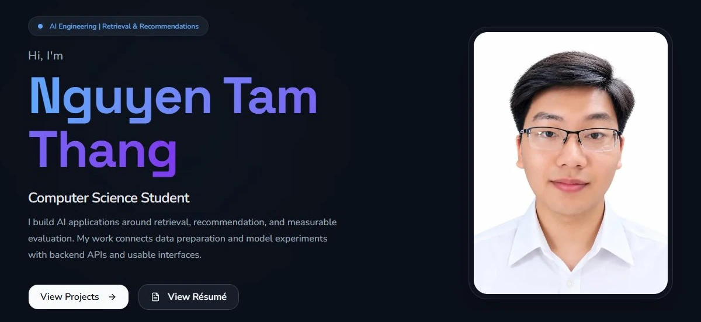
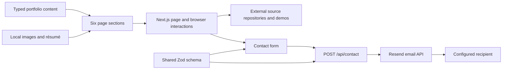

<h1 align="center">Nguyen Tam Thang — Portfolio</h1>

<p align="center">
  A personal portfolio presenting AI engineering work through technical decisions, scoped results, and working interfaces.
</p>

<p align="center">
  <a href="package.json"></a>
  <a href="package.json"></a>
  <a href="tsconfig.json"></a>
  <a href="package.json"></a>
</p>

<p align="center">
  <a href="https://nguyentamthang.vercel.app/">Live site</a> &nbsp;|&nbsp;
  <a href="#featured-work">Projects</a> &nbsp;|&nbsp;
  <a href="#how-it-works">Architecture</a> &nbsp;|&nbsp;
  <a href="#quick-start">Run locally</a> &nbsp;|&nbsp;
  <a href="#validation-and-reproduction">Validation</a>
</p>



*Actual screenshot of the local interface. The deployed site may show an earlier revision until these changes are published. Project cover illustrations are concept artwork; their linked demos show the actual products.*

## Project highlights

I'm a Computer Science student at Ho Chi Minh City University of Technology (HCMUT – VNU-HCM), working toward AI Engineering. This site gives readers a short path from an engineering claim to its source code, evaluation context, and demo.

- **Evidence in context.** Project cards pair results with denominators, baseline comparisons, and limitations, including the difference between offline evaluation and a public demonstration.
- **Content separated from presentation.** A typed [content module](src/data/portfolio.ts) holds the biography, skills, project results, and links; individual sections render that content.
- **A complete contact flow.** Client and server share a Zod schema. A Next.js route validates submissions and sends plain-text email through Resend, with pending, success, and error states in the interface.

The site uses Next.js App Router, React, TypeScript, Tailwind CSS, Framer Motion, and Radix-based UI components. Images use `next/image`; Nunito and Space Grotesk are loaded through `next/font`.

## Featured work

| Project | Engineering focus | Source and demo |
| --- | --- | --- |
| Enterprise Knowledge Intelligence Platform | Hybrid retrieval, evaluation, cited generation, and API observability | [Source](https://github.com/Thazg/knowledge-intelligence-platform) / [Live demo](https://enterprisekip.vercel.app/) |
| E-commerce Recommendation System | Chronological evaluation, candidate retrieval, learned ranking, and model snapshots | [Source](https://github.com/Thazg/ecommerce-recsys) / [Shopping demo](https://shoprecome.vercel.app/) |
| Nova RAG Workspace | Account-scoped document search, streamed answers, and page/line source references | [Source](https://github.com/Thazg/NovaRAGChatBot) / [Live demo](https://novachatbot.vercel.app/) |

Each repository owns its benchmark protocol and reproduction instructions. The shopping demo uses a separate browser recommendation policy; it does not serve the full Retailrocket model. Retrieval metrics shown for KIP and Nova measure retrieval, not answer factuality. The fourth card presents this portfolio itself.

## Live site

Visit **[nguyentamthang.vercel.app](https://nguyentamthang.vercel.app/)** for the deployed portfolio. It presents projects, technical skills, education, a résumé link, and a contact form. AI inference belongs to the linked projects and does not run inside this site.

The portfolio can run locally without credentials. Email delivery requires server-side Resend configuration; viewing the site does not.

## How it works



The home page composes Home, About, Skills, Projects, Education, and Contact. Section components handle layout and interaction; the contact route is the only application API endpoint. No application database or CMS is required.

## Quick start

Use **Node.js 20.9 or newer** and npm. The current local environment was checked with Node.js 24.16.0 and npm 11.13.0. Dependency installation requires network access; a build also needs access to the Google Fonts used by `next/font`.

```bash
git clone https://github.com/Thazg/Portfolio.git
cd Portfolio
npm ci
npm run dev
```

Open [localhost:3000](http://localhost:3000). `npm ci` uses the committed lockfile.

### Optional email configuration

Create `.env.local` at the repository root:

```dotenv
RESEND_API_KEY=replace_with_your_resend_api_key
EMAIL_ADDRESS=recipient@example.com
EMAIL_FROM="Portfolio Contact <contact@your-verified-domain.com>"
```

| Variable | Purpose |
| --- | --- |
| `RESEND_API_KEY` | Server-side credential for email delivery |
| `EMAIL_ADDRESS` | Recipient for contact messages |
| `EMAIL_FROM` | Sender identity; use a verified sender domain for production |

Restart the server after changing environment variables. The route falls back to `Portfolio Contact <onboarding@resend.dev>` if `EMAIL_FROM` is absent; provider restrictions still apply. Without the key or recipient, submissions return a configuration error. Keep credentials server-side and out of Git.

For Vercel, import the repository as a Next.js project and configure these variables for the intended deployment environment. Redeploy after changing them.

## Validation and reproduction

The [CI workflow](.github/workflows/ci.yml) defines separate `Lint` and `Build` jobs on Node.js 24, using `npm ci`, for pull requests and pushes to `main`. This repository has no automated unit/E2E test suite. Run the same checks locally:

```bash
npm run lint
npm run build
npm run start
```

Run `start` after a successful build to inspect the production server on port 3000. Stop any development server already using that port.

| Check | Scope and evidence | Boundary |
| --- | --- | --- |
| ESLint and production build | Passed locally during the current UI update; commands are defined in [package.json](package.json) | Local checks; see [Actions](https://github.com/Thazg/Portfolio/actions) for published run status |
| Responsive layout | Browser screenshots inspected at 390, 768, and 1440 px | Visual checks at three widths, not exhaustive device coverage |
| Page content | Four visible project cards and six sections in the [content module](src/data/portfolio.ts) and [page composition](src/app/page.tsx) | Describes content scope, not a performance benchmark |
| Contact validation | Shared [Zod schema](src/lib/contact-schema.ts) and [server route](src/app/api/contact/route.ts) | Email delivery requires provider configuration and was not exercised in the current review |

For a manual check, navigate through every section, open the mobile menu, use Tab and Escape, inspect project links and the résumé, and check form validation with empty or invalid fields. In reduced-motion mode, also inspect reveal animations. Submit a valid form only when you intend to send a real email.

No Lighthouse score, accessibility certification, load-test result, or production latency measurement is claimed.

## Limitations

- Project results and external URLs are curated manually. They need review when an upstream benchmark, release, or demo changes.
- CSS reduces transitions and animations, but Framer Motion components do not explicitly read the reduced-motion preference. Full motion accessibility remains to be verified.
- The contact endpoint has field limits and a honeypot, but no application-level rate limiter or CAPTCHA. Its request-size check uses the declared `Content-Length`, not an enforced streamed-body limit.
- Email availability depends on Resend, sender verification, and deployment secrets. A successful build does not establish email deliverability.
- Local validation has not been repeated from a fresh checkout. Lint and build checks do not replace interaction tests, accessibility checks, or email delivery verification.

## Source guide and contributing

This small site keeps setup and validation instructions in this README. Use these files for implementation details:

| Location | Responsibility |
| --- | --- |
| [`src/data/portfolio.ts`](src/data/portfolio.ts) | Biography, skills, projects, metric context, education, and social links |
| [`src/sections/`](src/sections/) | Individual page sections |
| [`src/app/page.tsx`](src/app/page.tsx) | Section composition |
| [`src/app/layout.tsx`](src/app/layout.tsx) | Fonts, shared layout, metadata, and social preview |
| [`src/app/globals.css`](src/app/globals.css) | Theme tokens and global styles |
| [`src/lib/contact-schema.ts`](src/lib/contact-schema.ts) | Shared contact input validation |
| [`src/app/api/contact/route.ts`](src/app/api/contact/route.ts) | Server-side email delivery |
| [`public/`](public/) | Portraits, project covers, screenshots, and résumé |

For corrections or improvements, open an [issue](https://github.com/Thazg/Portfolio/issues) or pull request. Keep changes focused, run lint and build, and attach screenshots for visible changes. When changing a project result, include its source and evaluation scope. Never include credentials or private contact submissions.

## License and contact

This repository currently has no `LICENSE` file. Contact the author before reusing the code or personal assets; the portrait, résumé, and project artwork should not be treated as generic template content.

**Nguyen Tam Thang** — [Portfolio](https://nguyentamthang.vercel.app/) | [GitHub](https://github.com/Thazg) | [LinkedIn](https://www.linkedin.com/in/thangnguyen0512/)
